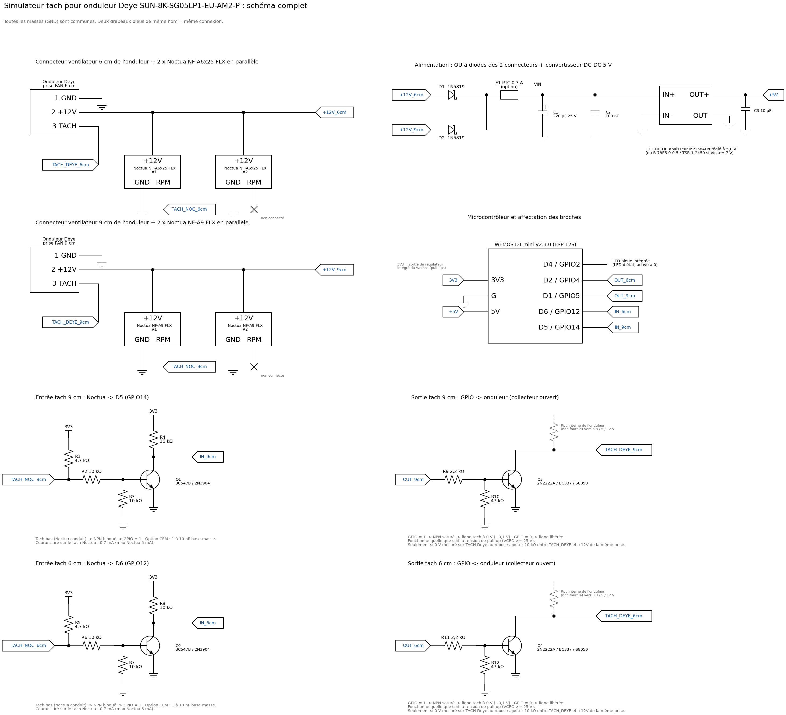

# Schéma électronique complet — simulateur tach Deye SUN-8K-SG05LP1-EU-AM2-P

Ce document décrit le matériel associé à `deye_fan/deye_fan.ino` : alimentation, deux étages
d'entrée (Noctua → ESP8266), deux étages de sortie (ESP8266 → onduleur), câblage des
ventilateurs, nomenclature, calculs et vérifications avant installation.



Version vectorielle : [`schema_complet.svg`](schema_complet.svg) (régénérable avec
`python outils/generer_schema.py`). Sur le schéma, deux drapeaux bleus portant le même nom sont
reliés électriquement ; **toutes les masses sont communes**.

---

## 1. Principe

```
 Prise FAN 6 cm Deye ──+12V──┬──────────────► 2 x Noctua NF-A6x25 FLX (alimentés comme avant)
                             └─►|─ D1 ─┐
 Prise FAN 9 cm Deye ──+12V──┬─────────┼────► 2 x Noctua NF-A9 FLX
                             └─►|─ D2 ─┴─► convertisseur 5 V ─► Wemos D1 mini
 Tach Noctua 9 cm #1 ──► étage NPN (Q1) ──► D5/GPIO14 ┐
 Tach Noctua 6 cm #1 ──► étage NPN (Q2) ──► D6/GPIO12 ┤  NMI Timer1 : mesure, x ratio, régénération
 TACH prise 9 cm Deye ◄── NPN coll. ouvert (Q3) ◄── D1/GPIO5 ┤
 TACH prise 6 cm Deye ◄── NPN coll. ouvert (Q4) ◄── D2/GPIO4 ┘
```

- Les Noctua restent alimentés **directement** par leur prise d'origine : l'onduleur garde le
  contrôle de leur alimentation (marche/arrêt, tension variable éventuelle).
- Un seul Noctua par canal est mesuré (le n° 1) ; le fil RPM du n° 2 est isolé, non connecté.
- La sortie vers l'onduleur est un **collecteur ouvert** : c'est la résistance de pull-up interne
  de l'onduleur (3,3 V, 5 V ou 12 V, inconnue) qui fixe le niveau haut. Le montage fonctionne donc
  avec n'importe laquelle de ces tensions, sans modification.

---

## 2. Alimentation

```
 Prise FAN 6 cm, broche +12V  ──►|──┐ D1 1N5819
                                    │
                                    ├──[ F1 PTC 0,3 A (option) ]──┬─────────┬──────── IN+ ┌──────────────┐ OUT+ ──┬──── 5V  (Wemos)
                                    │                             │+        │             │ U1 DC-DC     │        │
 Prise FAN 9 cm, broche +12V  ──►|──┘ D2 1N5819                 C1 220µF  C2 100nF        │ abaisseur    │      C3 10µF
                                                                  │ 25 V    │             │ réglé 5,0 V  │        │
 Broches GND (6 cm et 9 cm) ──────────────────────────────────────┴─────────┴──────── IN- └──────────────┘ OUT- ─┴──── G   (Wemos)
```

| Repère | Rôle | Pourquoi ce choix |
|---|---|---|
| D1, D2 (1N5819) | « OU » à diodes | Le Wemos est alimenté par la prise qui a la tension la plus haute, et continue de fonctionner si une seule prise est alimentée. Les diodes empêchent toute circulation de courant d'une prise vers l'autre : relier directement les deux +12V court-circuiterait deux sorties de l'onduleur qui peuvent être à des tensions différentes, et ferait tourner des ventilateurs que l'onduleur a coupés. Schottky : chute de tension faible (≈ 0,3 V). |
| F1 (option) | Protection | Fusible réarmable : protège les sorties ventilateur de l'onduleur en cas de court-circuit dans le montage. |
| C1, C2 | Découplage | C1 absorbe les pointes de courant du WiFi (≈ 300 mA pendant quelques ms côté 3,3 V) et les creux si l'alimentation ventilateur est hachée ; 25 V pour une marge sur 12 V. C2 filtre les hautes fréquences au plus près de U1. |
| U1 | 12 V → 5 V | Module abaisseur MP1584EN (entrée 4,5–28 V, rendement ≈ 85 %) : **régler la sortie à 5,0 V avec le potentiomètre AVANT de brancher le Wemos**. Alternatives prêtes à l'emploi, sans réglage : RECOM R-78E5.0-0.5 (entrée ≥ 7 V) ou TRACO TSR 1-2450 (entrée ≥ 6,5 V). |
| C3 | Découplage 5 V | Au plus près de la broche 5V du Wemos. Le régulateur 3,3 V intégré du Wemos fait le reste. |

**Ne jamais relier un +12V directement à la broche 5V du Wemos** : le régulateur intégré du
Wemos n'accepte pas plus de ≈ 6 V.

**Pourquoi un convertisseur acheté plutôt que des composants de la liste ?** Avec seulement des
résistances et des NPN, on ne peut pas faire de régulateur correct : sans diode Zener, pas de
tension de référence, et un NPN TO-92 monté en ballast dissiperait (12 − 5) V × 80 mA ≈ 0,6 W,
soit la limite absolue d'un boîtier TO-92, dans un onduleur déjà chaud. Un module abaisseur coûte
1 à 2 € et chauffe à peine.

**Bilan de consommation.** Le Wemos (WiFi actif en permanence, sans mise en veille du modem pour
garantir la réactivité) consomme ≈ 70–80 mA sous 5 V, soit ≈ 40 mA moyens sous 12 V après le
convertisseur (pointes ≈ 150 mA lissées par C1). Les NMB d'origine consommaient bien plus que les
Noctua (fiche NMB : 0,22 A pour le 06025VE-12N) : les prises de l'onduleur fournissent donc sans
difficulté deux Noctua plus le montage.

**Plage de fonctionnement.** Si l'onduleur fait varier la tension des ventilateurs, le Wemos reste
alimenté tant qu'au moins une prise fournit ≈ 4,5 V ou plus (chute de la diode, puis du
convertisseur, puis du régulateur 3,3 V intégré). En dessous, les ventilateurs sont de toute
façon quasi arrêtés.

---

## 3. Étages d'entrée : tach Noctua → ESP8266 (×2)

Canal 9 cm : Q1, R1–R4, vers D5 / GPIO14. Canal 6 cm : Q2, R5–R8, vers D6 / GPIO12.

```
                 3V3                           3V3
                  │                             │
                 ┌┴┐                           ┌┴┐
              R1 │ │ 4,7 kΩ                 R4 │ │ 10 kΩ
                 └┬┘                           └┬┘
                  │                             ├──────────────► D5 / GPIO14  (IN_9cm)
                  │       R2 10 kΩ              │ C
 RPM Noctua ──────┴───────/\/\/\/───┬──────── B ┤   Q1  BC547B / 2N3904 / BC548 / S9014 ...
 9 cm n°1                           │           │ E
 (collecteur ouvert)               ┌┴┐          │
                                R3 │ │ 10 kΩ    │
                                   └┬┘          │
 GND ───────────────────────────────┴───────────┴──────────────── GND commun
                          (option CEM : 1 à 10 nF entre B et GND)
```

Fonctionnement (l'étage inverse le signal ; le firmware en tient compte avec `IN_PULSE_LEVEL = 1`) :

| Tach Noctua | Base Q1 | Q1 | GPIO |
|---|---|---|---|
| tirée à la masse (impulsion) | ≈ 0 V | bloqué | **1** (R4) |
| relâchée | ≈ 0,65 V | saturé | **0** |

Calculs :

- **Courant tiré sur la sortie tach du Noctua** : 3,3 V / 4,7 kΩ = **0,7 mA** (Noctua : 5 mA max).
- **Courant de base, tach relâchée** : (3,3 − 0,65) / (4,7 k + 10 k) ≈ 0,18 mA, dont 0,065 mA
  partent dans R3 : **Ib ≈ 0,115 mA**. Courant collecteur 3,3 V / 10 kΩ = 0,33 mA, soit un gain
  forcé ≈ 3 : saturation franche avec n'importe quel NPN de la liste (gain ≥ 100).
- **Tach à la masse** : base ≈ 0 V grâce au pont R2/R3, donc Q1 bloqué de façon certaine.
- **Pourquoi un transistor plutôt qu'un fil direct ?** Le GPIO ne voit jamais que 0 / 3,3 V, quoi
  qu'il arrive sur le fil du ventilateur : même si le fil RPM se retrouvait à 12 V (erreur de
  câblage, ventilateur avec pull-up interne), le courant de base serait limité à
  (12 − 0,7) / 10 kΩ ≈ 1,1 mA. Les entrées de l'ESP8266 ne sont spécifiées que pour 3,3 V, et
  12 V les détruirait à coup sûr.
- **Filtrage** : l'anti-rebond numérique du firmware (3 échantillons à 50 µs) suffit en général.
  Le condensateur optionnel forme avec R2 ∥ R3 (5 kΩ) une constante de temps de 5 à 50 µs, utile si
  les fils sont longs ou passent près de l'étage de puissance.

---

## 4. Étages de sortie : ESP8266 → broche TACH de l'onduleur (×2)

Canal 9 cm : Q3, R9, R10, depuis D1 / GPIO5. Canal 6 cm : Q4, R11, R12, depuis D2 / GPIO4.

```
                                      vers broche TACH de la prise FAN 9 cm de l'onduleur
                                      (pull-up interne Deye vers 3,3 / 5 / 12 V : non fournie)
                                        ▲
                                        │  TACH_DEYE_9cm
                                        │
                      R9 2,2 kΩ         │ C
 D1 / GPIO5 ──────────/\/\/\/───┬──── B ┤   Q3  2N2222A / BC337 / S8050 / SS8050 ...
 (OUT_9cm)                      │       │ E
                               ┌┴┐      │
                           R10 │ │ 47 kΩ│
                               └┬┘      │
 GND ───────────────────────────┴───────┴──────────────── GND commun
```

| GPIO | Q3 | Ligne TACH de l'onduleur |
|---|---|---|
| 1 | saturé | ≈ 0,05 à 0,2 V (niveau bas) |
| 0 | bloqué | libérée : niveau haut fixé par l'onduleur |

Calculs :

- **Courant de base** : (3,3 − 0,7) / 2,2 kΩ − 0,7 / 47 kΩ ≈ **1,17 mA** (un GPIO ESP8266 fournit
  sans peine 12 mA).
- **Saturation garantie** avec un gain forcé de 10 jusqu'à Ic ≈ 12 mA, c'est-à-dire pour toute
  pull-up d'onduleur ≥ 1 kΩ sous 12 V (les pull-ups de tach sont typiquement de 4,7 à 10 kΩ, soit
  0,3 à 2,5 mA). Le niveau bas obtenu (< 0,2 V) est reconnu par toute logique 3,3 V, 5 V ou 12 V.
- **Tenue en tension** : VCEO ≥ 25 V pour 2N2222A, BC337, S8050, SS8050, 2N3904, BC547, C1815,
  2N5551, S9013, S9014 : largement au-dessus de 12 V. **Éviter le S9018** (transistor RF,
  VCEO = 15 V seulement) en sortie.
- **R10 (47 kΩ)** maintient Q3 bloqué pendant le reset et le démarrage de l'ESP8266 (GPIO en haute
  impédance), et si le Wemos n'est pas alimenté : la ligne est alors libérée.
- **Rapidité** : avec 10 kΩ de pull-up et ≈ 100 pF de câble, le front montant dure ≈ 1 µs ; le
  temps de stockage du NPN saturé (≈ 0,2–1 µs) est un retard **constant**, donc sans effet sur la
  période. À comparer à des demi-périodes de 2 à 3,5 ms.
- La documentation NMB des ventilateurs de la série VE indique une sortie tach **à collecteur
  ouvert**, 2 impulsions par tour, rapport cyclique 50 % : l'onduleur fournit donc lui-même la
  pull-up, et le signal émis (carré 50 %, 2 impulsions/tour) reproduit exactement celui d'origine.

**Option, seulement si nécessaire** : si la mesure de la section 8 donne 0 V sur la broche TACH
de l'onduleur au repos (aucune pull-up côté onduleur), ajouter une résistance de **10 kΩ entre
TACH_DEYE et le +12V de la même prise**. Le niveau haut redevient alors identique à celui d'un
ventilateur à sortie tirée vers son +12V.

---

## 5. Raccordement du Wemos D1 mini

| Broche Wemos | GPIO | Net | Relié à |
|---|---|---|---|
| D5 | GPIO14 | IN_9cm | collecteur Q1 + R4 |
| D6 | GPIO12 | IN_6cm | collecteur Q2 + R8 |
| D1 | GPIO5 | OUT_9cm | R9 (base Q3) |
| D2 | GPIO4 | OUT_6cm | R11 (base Q4) |
| D4 | GPIO2 | — | LED bleue intégrée (rien à câbler) |
| 5V | — | +5V | sortie U1 + C3 |
| G | — | GND | masse commune |
| 3V3 | — | 3V3 | R1, R4, R5, R8 (sortie du régulateur intégré, ≈ 2 mA utilisés) |

Broches choisies parce qu'elles n'ont **aucun rôle au démarrage** de l'ESP8266 (contrairement à
GPIO0, GPIO2 et GPIO15) et ne produisent pas d'impulsion parasite au reset (contrairement à
GPIO16, TX, RX). D3, D7, D8, D0, A0, TX et RX restent libres.

---

## 6. Câblage des ventilateurs

Numérotation des broches selon la convention ventilateur 3 fils : **1 = GND, 2 = +12V,
3 = TACH (RPM)**. Couleurs Noctua usuelles : noir = GND, jaune = +12V, vert = RPM
(vérifier sur votre câble). Sur l'onduleur, repérer les broches au multimètre (section 8).

| Net | Origine | Destinations |
|---|---|---|
| +12V_6cm | prise FAN 6 cm de l'onduleur, broche 2 | +12V des Noctua NF-A6x25 n°1 et n°2, anode de D1 |
| +12V_9cm | prise FAN 9 cm de l'onduleur, broche 2 | +12V des Noctua NF-A9 n°1 et n°2, anode de D2 |
| GND | broche 1 des **deux** prises | GND des 4 Noctua, C1, C2, U1 (IN−, OUT−), C3, Wemos G, R3, R7, R10, R12, émetteurs Q1 à Q4 |
| TACH_NOC_9cm | RPM du Noctua NF-A9 n°1 | R1 + R2 (étage d'entrée 9 cm) |
| TACH_NOC_6cm | RPM du Noctua NF-A6x25 n°1 | R5 + R6 (étage d'entrée 6 cm) |
| TACH_DEYE_9cm | collecteur Q3 | prise FAN 9 cm de l'onduleur, broche 3 |
| TACH_DEYE_6cm | collecteur Q4 | prise FAN 6 cm de l'onduleur, broche 3 |
| (aucun) | RPM des Noctua n°2 | isolé, non connecté (gaine thermo) |

Pourquoi ne pas relier les fils RPM des deux Noctua d'un même canal ? Deux sorties à collecteur
ouvert en parallèle donnent un « ET » logique de deux signaux non synchronisés : le signal obtenu
serait inexploitable.

Conseils pratiques :

- Pour récupérer les bons connecteurs côté onduleur, couper les câbles des NMB d'origine près du
  ventilateur et réutiliser leur fiche.
- Côté Noctua, prévoir sur la carte des embases mâles 3 broches au pas de 2,54 mm (connecteur
  ventilateur PC standard) : les Noctua s'y branchent sans couper leur câble.
- Ne pas utiliser les adaptateurs basse vitesse Noctua (L.N.A.) ou alors réduire les ratios en
  conséquence (voir README).
- **Variante 4 fils** (Noctua PWM au lieu de FLX) : laisser la broche 4 (PWM, bleu) non connectée,
  le ventilateur tourne alors à pleine vitesse ; tach identique. Adapter le ratio à leur vitesse
  maximale.
- Torsader chaque fil tach avec un fil de masse et garder le montage à l'écart de l'étage de
  puissance de l'onduleur.

---

## 7. Nomenclature

Composants de la liste fournie :

| Repère | Valeur | Qté | Remarque |
|---|---|---|---|
| — | Wemos D1 mini V2.3.0 (ESP-12S) | 1 | |
| Q1, Q2 | NPN petit signal : BC547B, BC548, 2N3904, S9014, S9013, C1815, C945… | 2 | entrées |
| Q3, Q4 | NPN : 2N2222(A), BC337, S8050, SS8050, 2N3904… (**pas S9018**) | 2 | sorties |
| R1, R5 | 4,7 kΩ | 2 | pull-up tach Noctua |
| R2, R3, R4, R6, R7, R8 | 10 kΩ | 6 | |
| R9, R11 | 2,2 kΩ | 2 | base des NPN de sortie |
| R10, R12 | 47 kΩ | 2 | base → masse des NPN de sortie |

Composants à ajouter (non disponibles dans la liste, indispensables à une alimentation sûre) :

| Repère | Valeur | Qté | Remarque |
|---|---|---|---|
| D1, D2 | 1N5819 (ou SS14, SS34, 1N5817 : Schottky ≥ 20 V, ≥ 0,5 A) | 2 | OU à diodes |
| U1 | module MP1584EN réglé à 5,0 V (ou R-78E5.0-0.5, TSR 1-2450) | 1 | 12 V → 5 V |
| C1 | 220 µF 25 V électrolytique | 1 | |
| C2 | 100 nF céramique | 1 | |
| C3 | 10 µF ≥ 10 V | 1 | |
| F1 | PTC 0,3 A (ex. Bourns MF-R030) | 1 | option |
| — | 1 à 10 nF céramique | 2 | option CEM, entre base et masse de Q1 et Q2 |
| — | 10 kΩ | 2 | option, uniquement si l'onduleur n'a pas de pull-up (section 4) |
| — | plaque à pastilles, embases 3 broches, gaine thermo, entretoises isolantes | | |

### Brochage des transistors (boîtier TO-92, face plate vers soi, pattes vers le bas, de gauche à droite)

| Transistor | Brochage |
|---|---|
| BC547, BC548, BC337 | C – B – E |
| 2N3904, PN2222A, 2N5551, S8050, SS8050, S9013, S9014, S9018 | E – B – C |
| P2N2222A (marquage ON Semi) | C – B – E |
| C1815, C945 | E – C – B |

Le brochage varie selon les fabricants : **en cas de doute, vérifier au multimètre** (mode
diode : la base est la patte qui conduit vers les deux autres, ≈ 0,6–0,7 V, pointe rouge sur la
base pour un NPN).

---

## 8. Vérifications avant installation

**Toute intervention dans l'onduleur se fait onduleur arrêté et isolé : AC réseau, champs PV et
batterie déconnectés, puis attendre au moins 5 minutes (décharge des condensateurs, voir le manuel
Deye).** Les mesures sous tension ne doivent être faites que par une personne qualifiée.

1. **Masses communes (obligatoire, hors tension)** : à l'ohmmètre, la broche GND de la prise FAN
   6 cm et celle de la prise FAN 9 cm doivent être reliées (≈ 0 Ω). Si ce n'est pas le cas,
   l'onduleur commute probablement ses ventilateurs côté masse : **ne pas installer ce montage
   tel quel**, car relier les masses court-circuiterait cette commande.
2. **Repérage des broches** : identifier GND, +12V et TACH sur chaque prise (couleurs des fils NMB,
   sérigraphie de la carte, ou mesure sous tension avec les ventilateurs d'origine : ≈ 12 V entre
   +12V et GND ; la broche TACH affiche en continu environ la moitié de la tension de pull-up).
3. **Tension de pull-up TACH (facultatif)** : ventilateur débranché, onduleur en marche, tension
   entre TACH et GND = tension de pull-up (3,3, 5 ou 12 V). Le montage fonctionne dans tous les
   cas ; seul un résultat de 0 V demande l'option de la section 4.
4. **Réglage de U1** : alimenter le module seul en 12 V, régler 5,0 V en sortie, **puis**
   seulement raccorder le Wemos.
5. **Essai sur table** (sans l'onduleur) : alimentation 12 V de laboratoire sur les deux entrées
   +12V, Noctua branchés. L'interface web doit afficher les RPM lus et simulés ; à l'oscilloscope,
   avec une pull-up de 10 kΩ vers 5 V sur TACH_DEYE, on doit voir un signal carré de fréquence
   RPM simulés × 2 / 60.

---

## 9. Comportement en cas de défaut

| Situation | Réaction | Ce que voit l'onduleur |
|---|---|---|
| Noctua arrêté, bloqué ou débranché | plus d'impulsion depuis 500 ms : sortie arrêtée, ligne libérée | 0 tr/min : alarme ventilateur, comme avec un NMB bloqué |
| Prise ventilateur coupée par l'onduleur | le Noctua s'arrête, donc la sortie aussi | 0 tr/min (cohérent avec l'ordre d'arrêt) |
| Les deux prises coupées | Wemos non alimenté, NPN bloqués par R10/R12 | lignes libérées : 0 tr/min |
| Reset, plantage ou mise à jour du Wemos | GPIO en haute impédance, NPN bloqués | 0 tr/min pendant ≈ 0,3 à 1 s, puis reprise automatique (le moteur tach démarre avant le WiFi) |
| WiFi coupé, serveur web saturé, sauvegarde en flash | aucun effet : le traitement tach tourne en NMI depuis la RAM | signal inchangé |
| Parasite sur l'entrée | rejeté (anti-rebond 150 µs, fronts < 2 ms ignorés), compteur « parasites » incrémenté | signal inchangé |

Le montage ne fabrique **jamais** de RPM sans ventilateur qui tourne réellement : il multiplie
une vitesse mesurée, et une panne de ventilateur reste détectée par l'onduleur.

---

## 10. Sécurité

- **Ne jamais brancher l'USB du Wemos à un PC quand le montage est installé dans l'onduleur et
  alimenté** : la masse de l'électronique de l'onduleur n'est pas forcément au même potentiel que
  la terre du PC. Programmer le Wemos sur table (alimenté par l'USB seul), puis faire les mises à
  jour par le WiFi (`http://<ip>/update`).
- Isoler la carte (gaine thermo, entretoises, boîtier plastique ou ruban Kapton) et la fixer loin
  des dissipateurs et des pistes haute tension ; aucune pièce métallique libre dans l'onduleur.
- Les Noctua brassent moins d'air que les NMB d'origine. Le ratio masque cette différence aux yeux
  de l'onduleur : **surveiller les températures de l'onduleur** (application Deye / Solarman) lors
  des premières journées chaudes à forte puissance. Si l'onduleur régule la vitesse de ses
  ventilateurs à partir du tach (boucle fermée), il les fera tourner moins vite qu'avant : dans ce
  cas, baisser les ratios.
- Ouvrir et modifier l'onduleur peut faire perdre la garantie.
